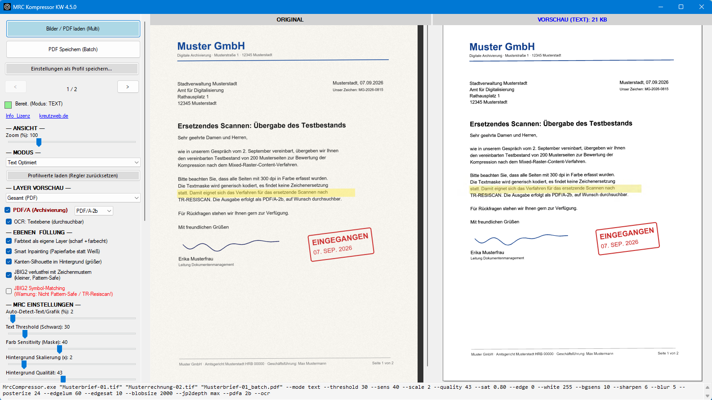

# MRC PDF Kompressor — gescannte Dokumente in winzige, scharfe PDFs (Windows)

Ein kostenloses Windows-Programm, das gescannte Seiten (TIFF, JPEG, PNG oder PDF) mit
**Mixed Raster Content (MRC)** in extrem kompakte PDF-Dateien verwandelt —
typisch **90–95 % kleiner** als der Original-Scan, bei gestochen scharfem Text.
Standardmäßig pattern-safe: Die Textmaske wird Pixel für Pixel kodiert, ohne
Zeichenmuster und ohne Zeichenvergleich — kein „Symbol Coding“ im Sinn der
**BSI TR-RESISCAN** (TR-03138, Anforderung A.SC.12).

**Webseite & Download:** https://kreutzweb.de/tool-mrc-pdf-kompressor.html



## Warum

Eine farbige A4-Seite mit 300 DPI ist als TIFF 25 MB groß und als JPEG immer
noch mehrere MB. Archive, DMS und Postfächer laufen damit schnell voll.
Kommerzielle MRC-Engines lösen das, werden aber pro Arbeitsplatz oder
Seitenvolumen lizenziert. Dieses Werkzeug liefert vergleichbare Ergebnisse —
im internen Vergleich mit 23 Musterseiten im Standard (streng pattern-safe) in
Summe rund 60 % kleiner als eine führende kommerzielle MRC-Lösung, die ihre
Schrift per Symbol-Matching kodiert, bei reinen Textseiten etwa gleichauf; mit
`--maxcompress` in Summe rund zwei Drittel kleiner und in allen fünf
Dokumentgruppen kleiner — und ist für Privatpersonen und kleine Unternehmen
kostenlos.

## Funktionen

- **Extreme Kompression**: aus einem 5-MB-Scan werden im Text-Modus deutlich
  unter 100 KB
- **Pattern-safe / TR-RESISCAN**: Standard ist die generische JBIG2-Kodierung —
  jedes Pixel der Textmaske wird so gespeichert, wie es ist, ohne Wörterbuch und
  ohne Zeichenvergleich (kein „Symbol Coding“, TR-03138 A.SC.12); `--patternsafe`
  erzwingt das auch gegen ein eigenes Profil
- **Pattern-safe ohne JBIG2** (`--ccitt`): dieselbe Sicherheit mit CCITT G4
  (Fax-Kodierung) für Stellen, die JBIG2 ganz ablehnen; Textseiten werden
  20–45 % größer
- **Maximale Kompression auf Wunsch** (`--maxcompress`): JBIG2-Symbol-Matching
  und Kantenangleichung gleicher Zeichen — reine Textseiten bis rund 60 %
  kleiner. Ähnliche Zeichen können dabei ersetzt werden (die bekannte
  JBIG2-Falle), also nicht für das ersetzende Scannen. Mit
  `--maxcompress --nojbig2symbols` wird kein Zeichen ersetzt: gleiche Zeichen
  werden einmal als Muster gespeichert und an jeder Stelle pixelgenau
  korrigiert (Textseiten meist 15–45 % kleiner)
- **Farbtext-Ebenen**: farbige Überschriften, Stempel, Logos und Textmarker
  werden automatisch erkannt und als eigene scharfe 300-DPI-Ebenen in
  Originalfarbe erhalten (bis zu 4 Farbcluster je Seite)
- **Farbiges Papier und Fotos auf Textseiten**: Briefe auf farbigem oder leicht
  getöntem Papier bleiben kleine Textseiten, das Papier wird eine gleichmäßige
  Fläche in seiner Farbe; Fotos und Illustrationen auf Textseiten kommen als
  eigenes Bild in Grafik-Qualität in die PDF, die Schrift drumherum bleibt scharf
- **Schrift auf Bildseiten**: auch auf Seiten, die als Bild gespeichert werden
  (Fotos, Pläne, Prospekte), kommt sicher erkannte schwarze Schrift scharf in
  eine Textmaske — zeilen- und absatzweise; das Bild darunter wird kleiner
- **Formulare und Screenshots**: grau hinterlegte Formularfelder bleiben erhalten (gerade
  Felder als Vektorfläche mit scharfer Kante), Formulare mit farbigen Rahmen bleiben kleine
  Textseiten, helle Ankreuzkästchen bleiben vollständig; Screenshots und Programmfenster auf
  Textseiten werden als Bild geschützt, ihre kleine Schrift bleibt lesbar
- **Prägesiegel**: deutlich ausgeprägte Blindprägungen (etwa ein Kammersiegel auf einem
  Zeugnis) werden erkannt und als zarte Schattierung erhalten, statt mit dem Papier
  weiß gebleicht zu werden
- **Smart Inpainting & Background Bleaching**: der Hintergrund hinter dem Text
  wird mit der echten Papierfarbe rekonstruiert, Grauschleier und
  Durchscheinen entfernt — keine Halos, kleinere Dateien
- **PDF/A-1b bis PDF/A-4** für die Langzeitarchivierung (ISO 19005; Stufen 1b, 2b, 2u, 3b,
  3u, 4), jede Stufe geprüft mit veraPDF – ab PDF/A-2 (Standard: 2b) bleibt der Hintergrund
  JPEG 2000, die Datei so klein wie ohne PDF/A
- **Durchsuchbar per OCR (optional)**: die integrierte Texterkennung legt eine
  unsichtbare, wortgenaue Textebene über die Seite — Volltextsuche, Markieren
  und Kopieren; läuft lokal ohne Cloud (PaddleOCR-Modelle auf ONNX Runtime),
  auch zusammen mit PDF/A, rund 6 KB je Seite
- **PDF als Eingabe**: Scan-PDFs (Kopierer, Scanner) und digitale PDFs werden zu
  kleinen, durchsuchbaren PDF/A; vorhandener Text, Links und Lesezeichen bleiben erhalten,
  auf Dateianhänge (z. B. von E-Rechnungen) weist das Programm hin – sie gehen verloren
- **Mehrseitige TIFFs**, Ordner und Wildcards als Eingabe, parallele
  Seitenverarbeitung auf Mehrkern-CPUs (bis zu 8 Seiten gleichzeitig)
- **Moderne Oberfläche** mit Echtzeit-Vorschau (Original und Ergebnis
  nebeneinander), synchronem Zoom, Ebenen-Ansicht, Profilen („Text", „Grafik", …),
  hell oder dunkel passend zu Windows; Dateien und Ordner lassen sich ins Fenster
  ziehen, die passende Kommandozeile lässt sich mit einem Klick kopieren
- **Eigene Profile**: beliebig viele benannte Profile in der Oberfläche
  speichern und per `--profile "Name"` in Skripten aufrufen
- **Voll skriptbare CLI**: Exit-Codes 0/1/2, Fortschritt je Seite, `--help`,
  jeder Profilwert überschreibbar

## Wie es funktioniert

1. **Text-Maske** — schwarzer Text wird in voller Auflösung (300 DPI)
   extrahiert und als JBIG2 kodiert — generisch, also Pixel für Pixel ohne
   Zeichenmuster (pattern-safe; CCITT G4 als Rückfallebene). Mit `--ccitt`
   als CCITT G4 statt JBIG2, mit `--maxcompress` mit Zeichenmustern und einem
   gemeinsamen Wörterbuch je Dokument, jede Seite wird zur Kontrolle zurückgelesen
2. **Farbtext-Ebenen** — farbige Schrift, Stempel und Logos werden nach Farbe
   gruppiert und als eigene Stencil-Ebenen eingebettet
3. **Hintergrund** — Papierstruktur und Fotos werden inpainted, geglättet,
   verkleinert und als JPEG 2000 (OpenJPEG) oder JPEG kodiert; gleichmäßig graue
   Formularfelder kommen als scharfe Vektorflächen darüber
4. **Bildbereiche** — Fotos, Illustrationen und Screenshots auf Textseiten werden als eigenes
   Bild in Grafik-Qualität eingebettet, dort entsteht keine Textmaske
5. **Textebene (optional)** — die Texterkennung legt den gelesenen Text
   unsichtbar über das Bild, damit die PDF durchsuchbar wird

Im PDF liegen diese Ebenen deckungsgleich übereinander: ein Bruchteil der
Originalgröße bei voller Lesbarkeit.

## Download & Installation

Über die Webseite als signiertes Setup (ca. 39 MB, Installation auch ohne
Administratorrechte) oder als ZIP (ca. 48 MB, davon rund 18 MB für die
Texterkennung im Ordner `ocr`). Das ZIP in einen beliebigen Ordner entpacken
und `MrcCompressor.exe` starten — nichts wird tief ins System geschrieben. Oder über den Windows-Paketmanager:

```
winget install DanielKreutz.MRCPDFKompressor
```
 `MrcCompressor.exe` ist digital signiert (Certum-Zertifikat auf
Daniel Kreutz); SHA256-Prüfsumme und unabhängige VirusTotal-Berichte stehen
auf der Download-Seite.

Voraussetzungen: Windows 10/11 64-Bit, .NET Framework 4.8,
[Visual C++ Redistributable x64](https://aka.ms/vc14/vc_redist.x64.exe) für die
Texterkennung und die JPEG-2000-Kodierung mit OpenJPEG. Das Setup installiert die
Laufzeit auf Wunsch nach.

## Kommandozeile

```
MrcCompressor.exe "Scan01.tif" "Archiv01.pdf" --mode text --pdfa 2u --ocr
MrcCompressor.exe Kopierer.pdf --pdfa --ocr
MrcCompressor.exe "Scan02.tif" "Archiv02.pdf" --profile "Mein Archivprofil"
MrcCompressor.exe C:\Scans\*.tif Stapel.pdf --mode auto
MrcCompressor.exe --help
```

| Option | Bedeutung |
|---|---|
| `--mode auto\|text\|image\|text2\|image2` | Verarbeitungsstrategie (Automatik erkennt Text- vs. Grafikseiten) |
| `--pdfa [stufe]` | PDF/A-Ausgabe, Stufe 2b (Standard), 1b, 2u, 3b, 3u oder 4 |
| `--ocr` | unsichtbare Textebene (durchsuchbare PDF) per Texterkennung |
| `--profile "Name"` / `--profiles` | eigenes Profil aufrufen / alle Profile auflisten |
| `--threshold 0-255` | Empfindlichkeit der Texterkennung |
| `--scale 1-10` | Verkleinerungsfaktor des Hintergrunds (stärkster Größenhebel) |
| `--quality 0-100` | Qualität des Hintergrunds (JPEG 2000 / JPEG) |
| `--patternsafe` | Pattern-Safe erzwingen (ist der Standard; gilt auch gegen ein Profil): generisches JBIG2 ohne Symbol Coding |
| `--ccitt` | Pattern-Safe ohne JBIG2: Textmaske als CCITT G4 (größer) |
| `--maxcompress` | maximale Kompression: Symbol-Matching und Kantenangleichung, **nicht** pattern-safe (Zeichen können ersetzt werden) |
| `--nojbig2symbols` | zusammen mit `--maxcompress`: ohne Zeichenersetzung (Zeichenmuster bitgleich) |
| `--noimageregions` | Fotos auf Textseiten nicht als eigenes Bild schützen |
| `--noimagetext` | Bildseiten ohne scharfe Textmaske (vollständig als Bild) |
| `--dpi N` | Auflösung für Bilder ohne DPI-Angabe erzwingen |

Jeder Modus startet mit seinem Profil aus `mrc_profiles.xml`; angegebene
Parameter überschreiben das Profil. Exit-Codes: 0 = ok, 1 = Fehler / keine
Seite, 2 = Bedienfehler. Die vollständige Parameter-Referenz steht auf der
Webseite.

## Lizenz

**PolyForm Small Business License 1.0.0**: kostenlos für Privatpersonen und
Organisationen mit weniger als 100 Personen **und** unter 1 Mio. USD
Jahresumsatz — größere Unternehmen benötigen eine kostenpflichtige Lizenz über
[kreutzweb.de](https://kreutzweb.de). Aufgebaut auf hervorragender
Open-Source-Software: ImageMagick (Magick.NET), SkiaSharp, iTextSharp LGPL,
potrace (GPL, Quellcode liegt bei), PDFium, OpenJPEG, Bouncy Castle, ONNX Runtime und
PaddleOCR-Modelle — siehe THIRD-PARTY-NOTICES.txt
im Paket.
