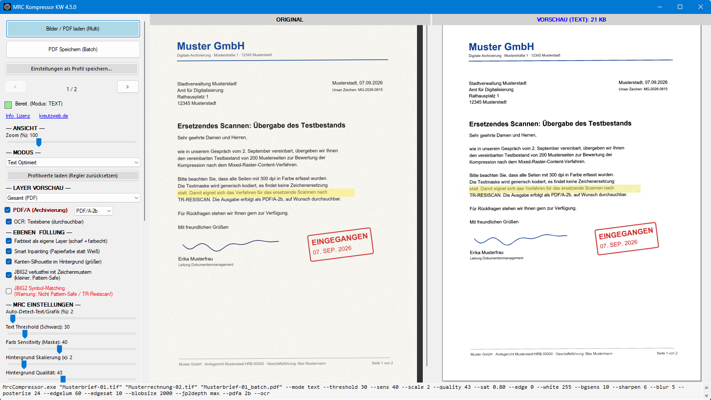

# MRC PDF Kompressor — scanned documents into tiny, sharp PDFs (Windows)

A free Windows program that turns scanned pages (TIFF, JPEG, PNG or PDF) into extremely
compact PDF files using **Mixed Raster Content (MRC)** — typically **90–95 % smaller**
than the original scan, with text that stays crisp. Pattern-safe by default (no
JBIG2 symbol substitution), so the method is suitable for replacement scanning
under the German BSI TR-RESISCAN.

**Website & download:** https://kreutzweb.de/tool-mrc-pdf-kompressor.html
([German](https://kreutzweb.de/tool-mrc-pdf-kompressor.html) · [English](https://kreutzweb.de/en/tool-mrc-pdf-kompressor.html))



## Why

A colour A4 page scanned at 300 DPI is 25 MB as TIFF and still several MB as
JPEG. Archives, document management systems and mailboxes fill up fast.
Commercial MRC engines solve this, but are licensed per seat or per page
volume. This tool delivers comparable results — in an internal comparison of
23 sample pages, half the total size of a leading commercial MRC solution at
the same legibility — and is free for private individuals and small businesses.

## Features

- **Extreme compression**: a 5 MB scan becomes well under 100 KB in text mode
- **Pattern-safe / TR-RESISCAN**: JBIG2 encoding without character
  substitution, lossless with character patterns — identical glyphs are stored
  once and corrected pixel by pixel wherever they occur, no glyph is ever
  replaced by a "similar" one (the classic JBIG2 pitfall); optional symbol mode
  for maximum compression when pattern safety is not required
- **Colour text layers**: coloured headings, stamps, logos and highlighter
  marks are detected automatically and kept as separate, sharp 300-DPI
  layers in their original colour (up to 4 colour clusters per page)
- **Coloured paper and photos on text pages**: letters on coloured or slightly
  tinted paper stay small text pages, the paper becomes an even area in its own
  colour; photos and illustrations on text pages go into the PDF as a separate
  image in graphics quality, while the surrounding text stays sharp
- **Smart inpainting & background bleaching**: the background behind the text
  is reconstructed with the real paper colour, grey haze and show-through are
  removed — no halos, smaller files
- **PDF/A-1b to PDF/A-4** output for long-term archiving (ISO 19005; levels 1b, 2b, 2u, 3b,
  3u, 4), each validated with veraPDF – from PDF/A-2 on (default: 2b) the background stays
  JPEG 2000, the file as small as without PDF/A
- **Searchable via OCR (optional)**: built-in text recognition places an
  invisible, word-accurate text layer over the page — full-text search,
  selecting and copying; runs locally without a cloud service (PaddleOCR
  models on ONNX Runtime), also together with PDF/A, around 6 KB per page
- **PDF as input**: scanned PDFs (copiers, scanners) and digital PDFs become small,
  searchable PDF/A; existing text, links and bookmarks are kept, file attachments
  (e.g. of e-invoices) are pointed out – they are lost in the conversion
- **Multi-page TIFF**, folders and wildcards as input, parallel page
  processing on multi-core CPUs (up to 8 pages at a time)
- **Split-view GUI** with live preview (original vs. result), synchronised
  zoom, layer view, profiles ("Text", "Graphic", …) and a generated command
  line you can paste into your scripts
- **Custom profiles**: save any number of named profiles in the GUI and run
  them from scripts with `--profile "Name"`
- **Fully scriptable CLI**: exit codes 0/1/2, per-page progress, `--help`,
  every profile value can be overridden

## How it works

1. **Text mask** — black text is extracted at full resolution (300 DPI) and
   encoded as JBIG2 — losslessly with character patterns and one shared
   dictionary per document, every page read back as a check (pattern-safe;
   CCITT G4 as fallback)
2. **Colour text layers** — coloured text, stamps and logos are clustered by
   colour and embedded as separate stencil layers
3. **Background** — paper texture and photos are inpainted, smoothed,
   downscaled and encoded as JPEG 2000 or JPEG
4. **Image regions** — photos and illustrations on text pages are embedded as a
   separate image in graphics quality, no text mask is created there
5. **Text layer (optional)** — text recognition places the recognised text
   invisibly over the image so the PDF becomes searchable

The PDF stacks these layers exactly on top of each other: a fraction of the
original size, full legibility.

## Download & installation

From the website as a signed setup (~39 MB, installs without administrator
rights if you like) or as a ZIP (~48 MB, about 18 MB of which for text
recognition in the `ocr` folder). Unzip the ZIP into any folder and run
`MrcCompressor.exe` — nothing is written deep into the system.
Or via the Windows Package Manager:

```
winget install DanielKreutz.MRCPDFKompressor
```

`MrcCompressor.exe` is digitally signed (Certum certificate issued to Daniel
Kreutz); the SHA256 checksum and independent VirusTotal reports are published
on the download page.

Requirements: Windows 10/11 64-bit, .NET Framework 4.8,
[Visual C++ Redistributable x64](https://aka.ms/vc14/vc_redist.x64.exe) for text
recognition. The setup installs the runtime on request.

## Command line

```
MrcCompressor.exe "Scan01.tif" "Archive01.pdf" --mode text --pdfa 2u --ocr
MrcCompressor.exe Copier.pdf --pdfa --ocr
MrcCompressor.exe "Scan02.tif" "Archive02.pdf" --profile "My archive profile"
MrcCompressor.exe C:\Scans\*.tif Batch.pdf --mode auto
MrcCompressor.exe --help
```

| Option | Meaning |
|---|---|
| `--mode auto\|text\|image\|text2\|image2` | processing strategy (auto-detects text vs. graphic pages) |
| `--pdfa [level]` | PDF/A output, level 2b (default), 1b, 2u, 3b, 3u or 4 |
| `--ocr` | invisible text layer (searchable PDF) via text recognition |
| `--profile "Name"` / `--profiles` | run a custom profile / list all profiles |
| `--threshold 0-255` | text detection sensitivity |
| `--scale 1-10` | background downscale factor (strongest size lever) |
| `--quality 0-100` | background JPEG 2000 / JPEG quality |
| `--jbig2symbols` | JBIG2 symbol matching (max. compression, **not** pattern-safe) |
| `--nojbig2lossless` | encode the text mask generically only, without character patterns (as up to 4.4.0) |
| `--noimageregions` | do not protect photos on text pages as a separate image |
| `--dpi N` | force resolution for images without DPI metadata |

Every mode starts with its profile from `mrc_profiles.xml`; explicit parameters
override the profile. Exit codes: 0 = ok, 1 = error / no page, 2 = usage error.
The full parameter reference is on the website.

## License

Licensed under the **PolyForm Small Business License 1.0.0**: free for
private individuals and for organisations with fewer than 100 people **and**
under USD 1M annual revenue — larger companies need a paid license via
[kreutzweb.de](https://kreutzweb.de). Built on excellent open-source software:
ImageMagick (Magick.NET), SkiaSharp, iTextSharp LGPL, potrace (GPL, sources
included), PDFium, Bouncy Castle, ONNX Runtime and PaddleOCR models — see
THIRD-PARTY-NOTICES.txt in the package.

---

*Deutsche Fassung: [README.de.md](README.de.md)*
